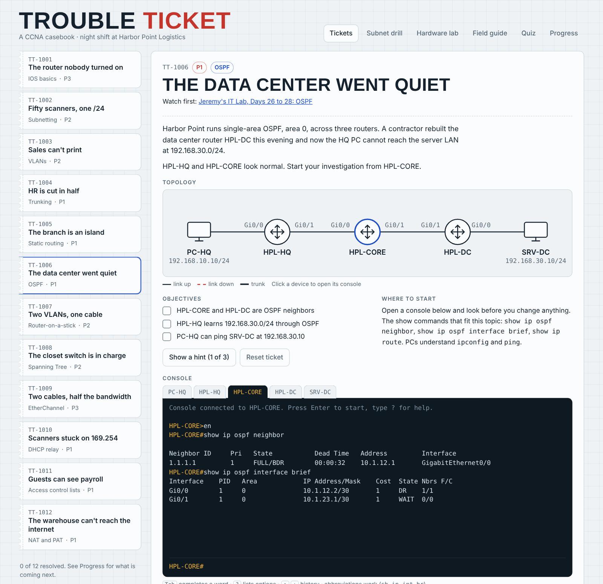
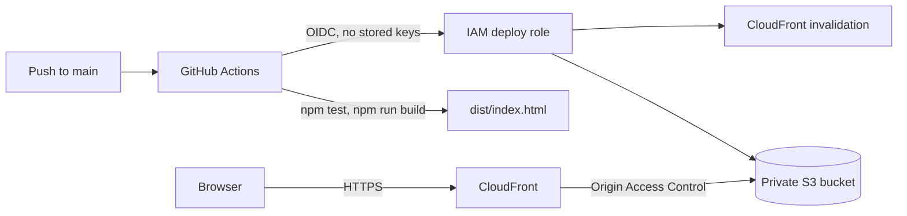

# Trouble Ticket

A CCNA troubleshooting game that runs in the browser. You play the night-shift network tech at a fictional Baltimore logistics company, open trouble tickets, and fix broken networks by typing real Cisco IOS commands into a simulated CLI.

**Live site:** `https://YOUR-CLOUDFRONT-DOMAIN` (see [Deploy](#deploy-to-aws))



## What's in it

| Section | What you do |
| --- | --- |
| **Tickets** | 18 scenarios, each with a story, a live topology diagram, objectives that check themselves, three hints, and a debrief with exam tips |
| **Course map** | All 63 days of Jeremy's IT Lab's CCNA course, each linked to the tickets, field-guide cards and labs that practice it |
| **Subnet drill** | Random addresses; find the network, broadcast, host range, host count and mask against the clock |
| **Hardware lab** | Pick the right cable for 10 connections, find ports on clickable switch and router panels, and learn the device families |
| **Field guide** | 52 protocol cards organized by the six CCNA 200-301 exam domains, plus a port-number table |
| **Quiz** | 86 multiple-choice questions with explanations; missed questions go into a review pile |

### The tickets

| # | Ticket | Topic |
| --- | --- | --- |
| TT-1001 | The router nobody turned on | IOS basics |
| TT-1002 | Fifty scanners, one /24 | Subnetting |
| TT-1003 | Sales can't print | VLANs |
| TT-1004 | HR is cut in half | 802.1Q trunking |
| TT-1005 | The branch is an island | Static routing |
| TT-1006 | The data center went quiet | OSPF |
| TT-1007 | Two VLANs, one cable | Router-on-a-stick |
| TT-1008 | The closet switch is in charge | Spanning Tree |
| TT-1009 | Two cables, half the bandwidth | EtherChannel (LACP) |
| TT-1010 | Scanners stuck on 169.254 | DHCP relay |
| TT-1011 | Guests can see payroll | Extended ACLs |
| TT-1012 | The warehouse can't reach the internet | NAT and PAT |
| TT-1013 | IPv6 stops at headquarters | IPv6 static routing |
| TT-1014 | Passwords in clear text | SSH hardening |
| TT-1015 | The new hire's port is dead | Port security |
| TT-1016 | One gateway down, whole floor down | HSRP |
| TT-1017 | The DR site is invisible | EIGRP |
| TT-1018 | A rogue DHCP server in sales | DHCP snooping and DAI |

Each ticket links to the matching lesson in Jeremy's IT Lab's free CCNA course and names the Packet Tracer lab to do next.

## How it works

The game is plain JavaScript with no framework and no runtime dependencies.

- **`src/engine.js`** models devices, interfaces and links, and decides whether a ping succeeds by actually forwarding the packet: ARP-style Layer 2 reachability per VLAN (access ports, 802.1Q trunks, router subinterfaces), longest-prefix-match routing, static routes, OSPF adjacency rules (area, subnet, passive interfaces) and shortest paths, ACLs on interfaces in and out, and PAT. Spanning Tree root election and port roles, EtherChannel negotiation, DHCP relay, EIGRP neighbors (AS number, passive interfaces), HSRP active election and failover, port security with sticky MACs and err-disable, DHCP snooping and Dynamic ARP Inspection, IPv6 static routing, and SSH/Telnet logins against VTY settings are modeled too.
- The same file holds the **CLI**: user, privileged, global, interface, VLAN, router and line modes, IOS-style abbreviations (`sh ip int br`), Tab completion, `?` help, `do`, `interface range`, and IOS-style errors with the `^` marker.
- **`src/scenarios.js`** defines the 18 tickets. Each objective is a function that inspects the live network model, so any correct fix passes, not just one typed answer.
- **`src/guide.js`** and **`src/hardware.js`** hold the field guide, quiz bank and hardware lab.
- **`src/app.js`** is the interface. Progress saves to the browser's localStorage.
- **`build.mjs`** inlines everything into one self-contained `dist/index.html`.



## Run it locally

Requires Node.js 20 or newer.

```bash
npm test          # replays every ticket's solution through the CLI engine
npm run build     # writes dist/index.html
npm run dev       # builds, then serves dist/ on http://localhost:3000
```

You can also open `dist/index.html` directly in a browser.

## Tests

`tests/tickets.test.mjs` uses Node's built-in test runner. For every ticket it checks that:

1. the ticket starts broken (not every objective passes), and
2. typing the reference solution into the CLI makes every objective pass.

It also checks realistic wrong fixes fail the way they would on real equipment, for example `switchport trunk allowed vlan 20` without `add`, a static route with no return path, an ACL in the right order but the wrong direction, bouncing an err-disabled port before clearing the old sticky MAC, or tuning HSRP priority while the second router is in the wrong group. A last test checks that all 63 days of the course map point at tickets and cards that exist.

## Deploy to AWS

The site is a private S3 bucket served through CloudFront with Origin Access Control. GitHub Actions deploys with short-lived OIDC credentials, so no AWS access keys are stored in GitHub.

1. **Create the stack** (one time):

   ```bash
   aws cloudformation deploy \
     --template-file infra/template.yaml \
     --stack-name trouble-ticket \
     --parameter-overrides GitHubRepo=YOUR-GITHUB-USER/ccna-trouble-ticket \
     --capabilities CAPABILITY_IAM \
     --region us-east-1
   ```

   If your account already has the GitHub OIDC provider, add `CreateOidcProvider=false` to the overrides.

2. **Read the outputs:**

   ```bash
   aws cloudformation describe-stacks --stack-name trouble-ticket --region us-east-1 \
     --query "Stacks[0].Outputs" --output table
   ```

3. **Add four repository variables** in GitHub (Settings → Secrets and variables → Actions → Variables), or with the GitHub CLI:

   ```bash
   gh variable set AWS_REGION --body us-east-1
   gh variable set AWS_DEPLOY_ROLE_ARN --body <DeployRoleArn output>
   gh variable set SITE_BUCKET --body <BucketName output>
   gh variable set CF_DISTRIBUTION_ID --body <DistributionId output>
   ```

4. **Push to `main`.** The workflow runs the tests, builds, syncs `dist/` to S3 and invalidates CloudFront. The site is at the `SiteUrl` output.

Hosting a single static page like this should cost little or nothing at low traffic. Set an AWS Budgets alarm anyway.

## Project structure

```
.
├── src/
│   ├── engine.js        network model + simulated IOS CLI
│   ├── scenarios.js     the 18 tickets
│   ├── guide.js         field guide cards and quiz bank
│   ├── course.js        63-day course map
│   ├── hardware.js      hardware lab
│   ├── app.js           user interface
│   ├── styles.css
│   └── index.html
├── tests/tickets.test.mjs
├── infra/template.yaml  S3 + CloudFront + GitHub OIDC deploy role
├── .github/workflows/deploy.yml
└── build.mjs
```

## Roadmap

- OSPFv3 and EIGRP for IPv6
- Layer 3 switch SVIs
- Wireless LAN controller WLAN setup

## Credits and disclaimer

Built by Ty Mackall while studying for the CCNA. Lessons are linked from [Jeremy's IT Lab](https://www.youtube.com/@JeremysITLab) free CCNA course; this project is not affiliated with Cisco or Jeremy's IT Lab. CCNA, Catalyst and IOS are trademarks of Cisco Systems. Harbor Point Logistics and every network in the game are fictional.

Licensed under the MIT License.
