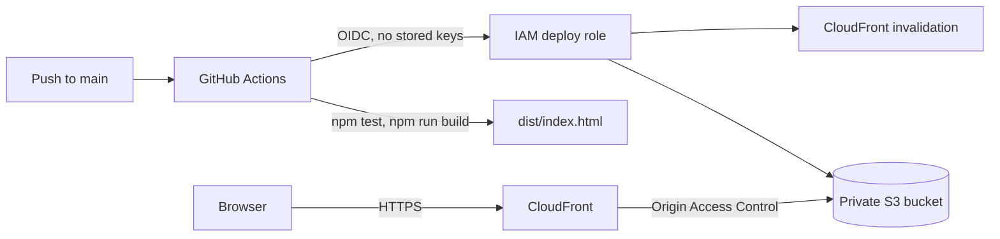

# Harbor Point Night Shift

A free CCNA 200-301 study site that runs in the browser. You play the night-shift network tech at a fictional Baltimore logistics company: read the lessons, fix broken networks by typing real Cisco IOS commands into a simulated CLI, build your own labs, drill flashcards, and sit timed mock exams.

**Live site:** [d1p1eji0s2dseq.cloudfront.net](https://d1p1eji0s2dseq.cloudfront.net)


## What's in it

The site opens on a night-shift front door: the Harbor Point NOC at 2 a.m., with one **Clock in** button that takes you to tonight's work. The content is organized as five rooms in the building: the **Training Room** (lessons and animated scenes), the **NOC Floor** (tickets, lab bench, hardware cage), the **Drill Room** (flashcards, subnetting, quick quiz), the **Certification Desk** (mock exams) and the **Shift Record** (progress, study plan, course map). The **Field Manual** opens from any page.

| Section | What you do |
| --- | --- |
| **Learn** | 54 lessons: a primer on the OSI and TCP/IP layers, then one per objective of the CCNA v1.1 exam blueprint. Each opens with a Harbor Point case file and has diagrams, the senior tech's notes, exam traps, "try it" blocks that run in the simulator, and a 3-question check (162 questions in all) |
| **Watch it happen** | 37 animated concept scenes, from switch MAC learning to OSPF elections, NAT and REST calls: packets travel the wires step by step while the senior tech narrates. Each plays inside its lesson, with play, pause, step and speed controls |
| **Tickets** | 23 troubleshooting scenarios, each with a story, a live topology, self-checking objectives, three hints and a debrief with exam tips |
| **Lab** | A Packet Tracer-style sandbox: drag routers, switches, Layer 3 switches, PCs and servers onto a canvas, cable ports, watch link lights, configure every device in the CLI, and watch pings and traceroutes travel the real path, ending with a red X where they die. Includes 15 guided projects with automatic checks |
| **Mock exam** | 433 original practice questions in the style of the best commercial practice exams: exhibits, multi-select, drag-to-order, matching and 25 hands-on CLI simulations. Five fixed practice exams (A to E) cover the whole bank, plus random full exams. All are 120 minutes, weighted like the real blueprint, with a score report by domain |
| **Flashcards** | 1015 cards in 11 decks (ports, acronyms, protocols, defaults, commands, OSI, subnetting, wireless, security, automation, terms) with spaced repetition and a typed-answer mode |
| **Course map** | All 63 days of Jeremy's IT Lab's free course, and all 53 v1.1 exam objectives, each linked to the lessons, tickets, cards and labs that practice it |
| **Field guide** | 58 protocol cards with a port table and a 98-question quick quiz |
| **Subnet drill** | Timed IPv4 subnetting practice plus IPv6 modified EUI-64 practice |
| **Hardware lab** | Pick the right cable, find ports on clickable switch and router panels, learn the device families, and configure WLANs in a wireless controller GUI (exam topics 2.9 and 5.10) |
| **Progress** | A study dashboard: what to do next, lessons and tickets done, flashcards due, and exam readiness by domain |
| **Study plan** | Enter your exam date and how many nights a week you can study. It builds a night-by-night schedule: lessons in blueprint order with their scenes, then the tickets, labs and flashcards that practice them, a checkpoint per domain, and practice exams A to E in a final review stretch. It ticks items off as you finish them, shows whether you're ahead or behind, reflows from today when you fall behind, and exports to your calendar (.ics) |
| **Sound** | Optional and off by default: an endless generated ambient night-shift track and subtle effects for pages, resolves, promotions and pings, with separate volume controls. Everything is synthesized in the browser |
| **Career mode** | Earn XP for everything you finish and rise from Night Shift Intern to CCNA-ready. Pager alerts, badges, a promotion stamp, and a shift record with your streak |

### The tickets

| # | Ticket | Topic |
| --- | --- | --- |
| TT-1001 | The router nobody turned on | IOS basics |
| TT-1002 | Fifty scanners, one /24 | Subnetting |
| TT-1003 | Sales can't print | VLANs |
| TT-1004 | HR is cut in half | Trunking |
| TT-1005 | The branch is an island | Static routing |
| TT-1006 | The data center went quiet | OSPF |
| TT-1007 | Two VLANs, one cable | Router-on-a-stick |
| TT-1008 | The closet switch is in charge | Spanning Tree |
| TT-1009 | Two cables, half the bandwidth | EtherChannel |
| TT-1010 | Scanners stuck on 169.254 | DHCP relay |
| TT-1011 | Guests can see payroll | Access control lists |
| TT-1012 | The warehouse can't reach the internet | NAT and PAT |
| TT-1013 | IPv6 stops at headquarters | IPv6 |
| TT-1014 | Passwords in clear text | SSH hardening |
| TT-1015 | The new hire's port is dead | Port security |
| TT-1016 | One gateway down, whole floor down | HSRP |
| TT-1017 | The DR site is invisible | EIGRP |
| TT-1018 | A rogue DHCP server in sales | DHCP snooping and DAI |
| TT-1019 | The weakest router is in charge | OSPF DR/BDR |
| TT-1020 | Retire the router-on-a-stick | Layer 3 switching |
| TT-1021 | The tracking site is unreachable | Static NAT and NAT pools |
| TT-1022 | A desk switch took over the network | STP protection |
| TT-1023 | The new branch router ships tomorrow | Device setup checklist |

Each ticket links to the matching lesson in Jeremy's IT Lab's free CCNA course and names the Packet Tracer lab to do next.

## How it works

The game is plain JavaScript with no framework and no runtime dependencies.

- **`src/engine.js`** models devices, interfaces and links, and decides whether a ping succeeds by actually forwarding the packet: ARP-style Layer 2 reachability per VLAN (access ports, 802.1Q trunks, router subinterfaces), longest-prefix-match routing, static routes, OSPF adjacency rules (area, subnet, passive interfaces) and shortest paths, ACLs on interfaces in and out, and PAT. Spanning Tree root election and port roles, EtherChannel negotiation, DHCP relay, EIGRP neighbors (AS number, passive interfaces), HSRP active election and failover, port security with sticky MACs and err-disable, DHCP snooping and Dynamic ARP Inspection, IPv6 static routing, and SSH/Telnet logins against VTY settings are modeled too.
- The same file holds the **CLI**: user, privileged, global, interface, VLAN, router and line modes, IOS-style abbreviations (`sh ip int br`), Tab completion, `?` help, `do`, `interface range`, and IOS-style errors with the `^` marker.
- **`src/scenarios.js`** defines the 23 tickets. Each objective is a function that inspects the live network model, so any correct fix passes, not just one typed answer.
- **`src/guide.js`**, **`src/hardware.js`** and **`src/wlc.js`** hold the field guide, quick quiz, hardware lab and wireless controller lab.
- **`src/lessons-*.js`**, **`src/questions-*.js`**, **`src/flashcards.js`** and **`src/projects.js`** are the study content; **`src/lessons-ui.js`**, **`src/exam-ui.js`**, **`src/flash-ui.js`** and **`src/sandbox.js`** are the screens that use it.
- **`src/app.js`** is the interface. Progress saves to the browser's localStorage.
- **`build.mjs`** inlines everything into one self-contained `dist/index.html`.



## Run it locally

Requires Node.js 20 or newer.

```bash
npm test          # replays every ticket's solution through the CLI engine
npm run build     # writes dist/index.html
npm run dev       # builds, then serves dist/ on http://localhost:3000
```

You can also open `dist/index.html` directly in a browser.

## Tests

`npm test` runs 1013 tests with Node's built-in test runner. They check that:

1. every ticket starts broken and typing its reference solution into the CLI makes every objective pass, and realistic wrong fixes fail the way they would on real equipment (for example `switchport trunk allowed vlan 20` without `add`, bouncing an err-disabled port before clearing the old sticky MAC, or changing OSPF priority without clearing the process);
2. every lab project fails at the start and passes after its solution;
3. every exam simulation is solvable, every question's answer is valid, and every lesson's "try it" commands run in the simulator;
4. the course map, the exam blueprint and every cross-link point at content that exists;
5. about 50 must-know values on the flashcards (administrative distances, timers, syslog levels, key ports) are correct.

## Deploy to AWS

The site is a private S3 bucket served through CloudFront with Origin Access Control. GitHub Actions deploys with short-lived OIDC credentials, so no AWS access keys are stored in GitHub.

1. **Create the stack** (one time):

   ```bash
   aws cloudformation deploy \
     --template-file infra/template.yaml \
     --stack-name trouble-ticket \
     --parameter-overrides GitHubRepo=YOUR-GITHUB-USER/ccna-trouble-ticket \
     --capabilities CAPABILITY_IAM \
     --region us-east-1
   ```

   If your account already has the GitHub OIDC provider, add `CreateOidcProvider=false` to the overrides.

2. **Read the outputs:**

   ```bash
   aws cloudformation describe-stacks --stack-name trouble-ticket --region us-east-1 \
     --query "Stacks[0].Outputs" --output table
   ```

3. **Add four repository variables** in GitHub (Settings → Secrets and variables → Actions → Variables), or with the GitHub CLI:

   ```bash
   gh variable set AWS_REGION --body us-east-1
   gh variable set AWS_DEPLOY_ROLE_ARN --body <DeployRoleArn output>
   gh variable set SITE_BUCKET --body <BucketName output>
   gh variable set CF_DISTRIBUTION_ID --body <DistributionId output>
   ```

4. **Push to `main`.** The workflow runs the tests, builds, syncs `dist/` to S3 and invalidates CloudFront. The site is at the `SiteUrl` output.

Hosting a single static page like this should cost little or nothing at low traffic. Set an AWS Budgets alarm anyway.

## Project structure

```
.
├── src/
│   ├── engine.js         network model + simulated IOS CLI
│   ├── scenarios.js      the troubleshooting tickets
│   ├── lessons-1.js      lessons for exam domains 1-2
│   ├── lessons-2.js      lessons for exam domains 3-6
│   ├── lessons-ui.js     lesson reader
│   ├── scenes.js         animation player for "Watch it happen"
│   ├── scenes-1.js       animated scenes, domains 1-2
│   ├── scenes-2.js       animated scenes, domains 3-6
│   ├── career.js         XP, ranks, badges and pager alerts
│   ├── theme.js          night/light theme toggle
│   ├── home.js           front door, rooms navigation
│   ├── plan.js           study plan (shift schedule)
│   ├── audio.js          generated ambient music and sound effects
│   ├── questions-1.js    mock exam questions, domains 1-2
│   ├── questions-2.js    mock exam questions, domains 3-6
│   ├── exam-ui.js        mock exam
│   ├── flashcards.js     flashcard decks
│   ├── flash-ui.js       spaced-repetition trainer
│   ├── sandbox.js        lab builder
│   ├── projects.js       guided lab projects
│   ├── guide.js          field guide cards and quick quiz
│   ├── course.js         63-day course map and v1.1 blueprint
│   ├── hardware.js       hardware lab
│   ├── wlc.js            wireless controller GUI lab
│   ├── app.js            routing, tickets, drill, dashboard
│   ├── *.css
│   └── index.html
├── tests/                one test file per module
├── infra/template.yaml   S3 + CloudFront + GitHub OIDC deploy role
├── .github/workflows/deploy.yml
└── build.mjs             inlines everything into dist/index.html
```

## Roadmap

- OSPFv3 and EIGRP for IPv6
- Layer 3 switch SVIs
- Wireless LAN controller WLAN setup

## Credits and disclaimer

Built by Ty Mackall while studying for the CCNA. Lessons are linked from [Jeremy's IT Lab](https://www.youtube.com/@JeremysITLab) free CCNA course; this project is not affiliated with Cisco or Jeremy's IT Lab. CCNA, Catalyst and IOS are trademarks of Cisco Systems. Harbor Point Logistics and every network in the game are fictional. All lessons, questions and flashcards are original; none are copied from any course, book or practice exam. Cisco does not publish an official passing score.

Licensed under the MIT License.
